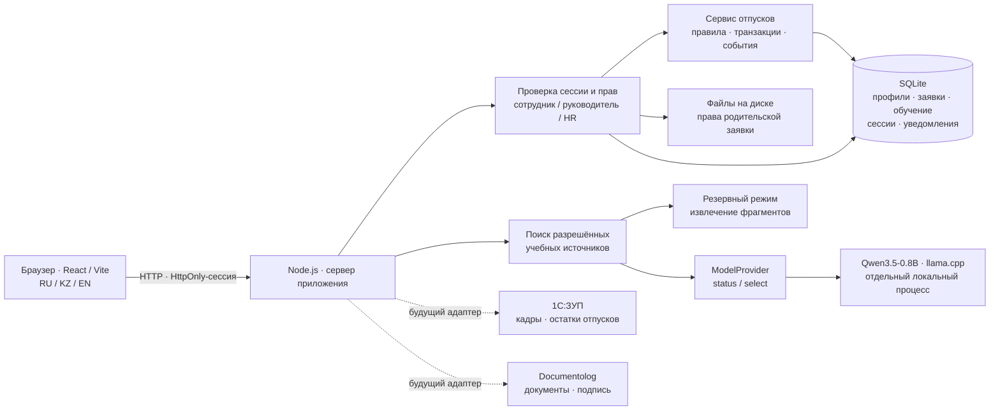
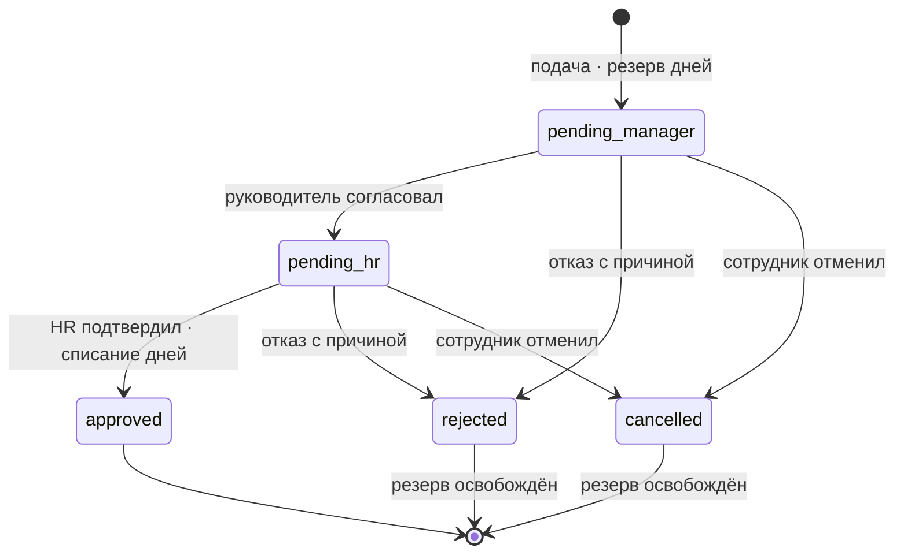
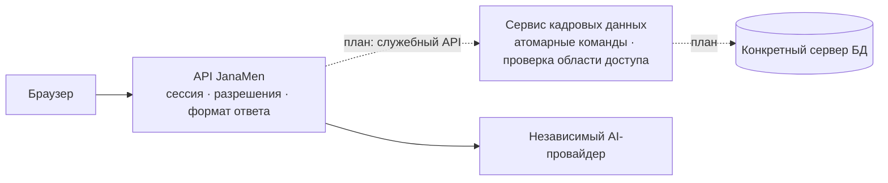

# Архитектура JanaMen

Прототип хранит кадровый профиль (`person_profiles`), снимки печатных заявлений (`request_documents`) и выполняет миграцию сохранённых демоадресов/текстов без смены паролей. `POST /api/people/:id/profile` разрешён только HR; `GET /api/requests/:id/document` проверяет обычный доступ к заявке и окончательное согласование. Снимок создаётся в одной транзакции с подтверждением HR. У старых одобренных заявок он появляется при первом формировании с явной отметкой.

Испытательный контур `scripts/eval-server.mjs` работает отдельным процессом на loopback-порту 8989. Он использует изолированные фикстуры из `evaluation/`, отдельные токены и временную синтетическую SQLite. В рабочем приложении нет тестовых заголовков выбора снимка или маршрутов `__eval__`. Подключается тот же evidence selector; несовпадение его raw-формата с генеративным контрактом набора сохраняется в отчётах.

Запуск `scripts/launch.mjs` сначала поднимает HR, затем допускает необязательную модель после проверки доступной памяти. `scripts/resources.mjs` выбирает малый профиль для 8 ГБ и учитывает systemd/cgroup. `scripts/ai-process-lock.mjs` предотвращает одновременную загрузку. Ошибка или остановка модели оставляет доступным явно обозначенный поиск по БЗ.

## Компоненты

Единый путь Digital HR: вход → профиль → отпуск → руководитель → HR → уведомление. Academy и ассистент JanaMen AI используют ту же учётную запись. Все кадровые данные и правила в MVP вымышлены.

В разработке Vite обслуживает интерфейс и проксирует `/api` на Node.js. В сборке Node.js обслуживает `dist` и API с одного адреса. SQLite и вложения находятся на постоянном диске. Firebase, Google OAuth и сторонний AI API в новом HR-пути не участвуют.

## Границы кода — реализовано

| Модуль | Ответственность | Чего он не делает |
|---|---|---|
| `server/app.mjs` | HTTP, сессия, Origin, чтение тела, ответы, файлы; создание сервисов | Не содержит переходы отпускной заявки и расчёт её резерва |
| `server/leave-service.mjs` | Подача, доступ к заявке, решения, снимок заявления, фиксация вложений; история и уведомления в транзакции | Не читает HTTP-запрос и не вызывает AI или внешние сервисы |
| `server/errors.mjs`, `server/validation.mjs` | Общие ошибки с кодами и прежняя валидация полей/дат | Не меняют права или состояние данных |
| `server/store.mjs` | SQLite, схема/миграции, транзакции, преобразование записей, общая видимость сотрудников | Не является удалённым сервисом данных |
| `server/assistant.mjs` | Ограничения вопроса, доступные источники, поиск, проверка выбора модели, цитирование и отказ | Не знает адрес, ключ и HTTP-формат модельного движка |
| `server/ai/local-model-provider.mjs` | Локальный runtime, статус, ограничение параллельного inference, вызов llama.cpp; отключённый провайдер | Не получает БД/сессию/профиль, не назначает права и не пишет кадровые данные |
| `scripts/launch.mjs`, `scripts/start-ai.mjs` | Запуск и остановка приложения и необязательного процесса модели | Не определяют HR-правила |

Это ограниченное разделение, а не полная многослойная переработка. Сервис отпусков пока использует синхронный SQLite напрямую; профили и Academy ещё имеют SQL в HTTP-модуле. Это явно оставленные места следующего этапа. Схема БД, маршруты, статусы, ответы, UX и алгоритм поиска этим рефакторингом не меняются.

`createLeaveService({ db, transaction })` предоставляет `get`, `submit`, `decide`, `document`, `checkAttachment`, `recordAttachment`. Транспорт передаёт сотрудника из проверенной сессии. `submit` возвращает `{ request, replayed }`; только HTTP-слой выбирает 201 или 200. Ошибки сохраняют прежние `status` и `code`, а перевод сообщения выполняется в HTTP-слое. Проверка доступа выполняется сервисом также при прямом вызове по ID.

Подача и решение остаются одной синхронной транзакцией: заявка, баланс, история, аудит, уведомления и финальный снимок либо сохраняются вместе, либо откатываются. Файловый поток остаётся в HTTP-слое: после записи файла сервис повторно проверяет этап и фиксирует метаданные; при ошибке файл удаляется. Это не распределённая транзакция файловой системы и БД.

## Модель данных

| Сущность | Содержание и ограничения |
|---|---|
| Person | Профиль, роль, `managerId`, остаток и резерв; пароль не входит в публичный объект |
| Учётная запись | Хеш scrypt с солью; серверная проверка, без выдачи хеша в API |
| Session | Случайная сессия со сроком действия, HttpOnly-cookie; отзыв при выходе |
| LeaveRequest | Автор, даты, рассчитанные сервером дни, причина, статус, история |
| Attachment | Имя, MIME, размер, связь с заявкой; байты на серверном диске |
| Course | Переведённые уроки и тест, порог прохождения, публикация |
| Enrollment | Назначение, пройденные уроки, балл, результат конкретного сотрудника |
| Notification | Получатель, локализованный текст, сущность, отметка прочтения |
| KnowledgeDocument | Учебный текст RU/KZ/EN, раздел, версия, разрешённая аудитория |

Сервер сам задаёт автора, количество дней и статус заявки. История фиксирует исполнителя и время. Ключи правильных ответов исключаются из данных обучающихся и доступны HR-редактору. Балл вычисляется сервером.

## Роли

| Действие | Сотрудник | Руководитель | HR |
|---|---|---|---|
| Свой профиль и отпуск | Да | Да | Да |
| Данные прямой команды | Нет | Разрешённые сведения | Да |
| Другая команда | Нет | Нет | Да |
| Первое решение | Нет | Прямые подчинённые | Без обхода первого этапа |
| Окончательное решение | Нет | Нет | После руководителя, кроме собственной заявки |
| Создание сотрудников | Нет | Нет | Да |
| Редактор и назначение курсов | Нет | Нет | Да |
| Файл заявки | По правам заявки | По правам заявки | По правам заявки |

Проверки выполняются на сервере для каждого запроса, включая файл и прямой доступ по ID. Скрытые кнопки — только удобство интерфейса. Ассистент фильтрует источники по роли до передачи контекста модели; кадровые записи и пароли в контекст не включаются.

## Согласование отпуска

Календарные дни считаются включительно, без отдельного исключения праздников. Проверяются дата, будущее начало, порядок дат, доступный остаток и пересечения. Повторное решение по завершённой заявке не списывает дни снова. Состояние и остаток сохраняются согласованно в SQLite. Реальный производственный расчёт должен поступать из 1С:ЗУП или утверждённых правил работодателя.

## Academy

HR публикует курс и назначает сотруднику. Сервер сохраняет завершение уроков. После всех уроков обучающийся отправляет варианты ответов; сервер вычисляет балл и сохраняет результат. Порог демокурсов — 80%: при четырёх вопросах нужны четыре правильных ответа. Неуспешный тест можно повторить. События обучения попадают в уведомления.

Курсы «Первые шаги в JanaMen» и «Данные под защитой»: по три урока и четыре вопроса на русском, казахском и английском. Перед производственным использованием нужны проверка переводов и утверждение учебных материалов.

## Локальный ассистент JanaMen AI

`npm run ai:setup` загружает Qwen3.5-0.8B Q4_0 GGUF (около 563 МБ, Apache 2.0). На Linux x64 по умолчанию используется готовый официальный CPU-движок `llama.cpp b8936` (архив около 14 МБ), включающий baseline/AVX1-варианты для старых процессоров. Нужны `curl`, `tar` и около 1 ГБ диска. Релиз и модель зафиксированы; SHA-256 обоих артефактов проверяется перед использованием. Модель не обучалась командой дополнительно.

`node scripts/setup-ai.mjs --build` включает сборку из исходников; она также используется как резервный путь для другой архитектуры. Для неё нужны `base-devel`, `cmake`, `git`, `curl`, около 2 ГБ диска и дополнительное время. По умолчанию длинная компиляция на Linux x64 не выполняется.

`npm run ai:start` запускает процесс только на loopback `127.0.0.1:8766`. Внутренний канал между сервером и движком не требует внешнего сервиса или API-ключа провайдера. Служебный локальный ключ генерируется в `.local-ai/runtime.json`. Рекомендуемый запуск в отдельном терминале, до демонстрации. Число потоков: `ASAR_AI_THREADS` от 1 до 8; порт: `ASAR_AI_PORT`.

Алгоритм:

1. Проверить сессию и разрешённую аудиторию источников.
2. Найти релевантные выдержки из учебных правил.
3. Без подходящего источника вернуть отказ и направить в HR.
4. Локальная модель выбирает ID подтверждающих предложений в ограниченной JSON-схеме.
5. Сервер формирует текст из исходных подтверждённых предложений и показывает открываемые источники.

Нейросеть не сочиняет окончательную кадровую политику. Если движок недоступен, занят или превышен таймаут, показывается честный режим `knowledge_search` с выдержками. Вопрос о собственном остатке обрабатывается сервером по текущей учётной записи; кадровые данные не отправляются модели. Попытка получить чужие сведения не расширяет доступ к документам.

Такой подход позволяет обновлять правила без обучения модели. Поиск не гарантирует идеальную релевантность: перед защитой проверяются типовые вопросы, RU/KZ/EN, неизвестные темы и попытки получить запрещённые сведения.

## Отключение и замена AI — граница реализована

Модель входит в локальный комплект прототипа, но не загружается внутрь процесса Node.js: это отдельный `llama-server`, доступный приложению по loopback HTTP. Браузер обращается только к `/api/assistant`. Служебный ключ runtime не отправляется браузеру. Вопрос или тело запроса не могут выбрать провайдера, URL, ключ или роль.

Отключить автоматический запуск модели можно через `JANAMEN_RESOURCE_PROFILE=off` при запуске `npm start` / `npm run dev`. Для сервера и адаптера поддерживаются также `ASAR_AI_DISABLED=1` и прежнее имя `ASAR_DISABLE_AI=1`. Уже запущенный отдельно `llama-server` нужно остановить отдельно. После остановки веса и runtime можно убрать из локальной поставки; вход, профиль, заявки и Academy продолжают работать, ассистент использует явно обозначенный `knowledge_search`. Этот режим не означает работу нейросети и не гарантирует релевантность найденной цитаты.

Точка замены — серверный параметр `createApplication({ modelProvider })`, передаваемый далее в `createAssistant`. По умолчанию используется общий локальный провайдер, чтобы HTTP-приложение и испытательный selector не запускали конкурентный inference в одном процессе. Для полного отказа от обращения к модели можно передать `createDisabledModelProvider()`.

| Контракт провайдера | Значение |
|---|---|
| `model` | Подпись модели для сообщения о недоступности |
| `status()` | Promise с `{ ready, engine, model }`; сбой не останавливает HR API |
| `select({ question, previews })` | Promise с `raw_model_output`: строка с JSON-числом 0, 1 или 2; 0 — источника нет |
| Необязательные измерения | `model_request_ms`, `generation_ms`, `input_tokens`, `output_tokens`; отсутствие измерения не заменяется выдуманным нулём |
| Ошибки | `model_unavailable`, `model_busy`, `model_http_error`; неверный JSON/номер проверяет ассистент, прочие ошибки приводят к резервному поиску |

Провайдер получает только вопрос и предварительно отобранные разрешённые выдержки. Источники, итоговый текст и кадровые числа он не возвращает в пользовательский ответ напрямую: ассистент проверяет номер и берёт соответствующую исходную цитату. Дополнительные поля вроде `answer` или `sources` провайдера игнорируются. Для другого модельного API нужен новый модуль, реализующий этот контракт и нормализующий ответ; интерфейс пользователя и правила доступа остаются прежними.

Удалённый модельный API **не подключён**. При его реализации необходимо отдельно настроить серверные URL/секреты, предельное время, допустимый объём контекста, обработку лимитов и правило передачи данных. Режим ответа сейчас называется `local_model`: для реального удалённого провайдера потребуется отдельно согласовать совместимое обозначение, чтобы не выдавать удалённый inference за локальный.

### Версия модели и объединение веток

Текущая база этой ветки — `c4ecab1`; в ней закреплены Qwen3.5-0.8B, короткие 35-символьные previews и таймаут inference 60 секунд (статус — 700 мс). Рефакторинг сохраняет эти настройки и **не подтверждает ответ за 5–10 секунд**. Выбранная для демонстрации Qwen3-0.6B, полные фрагменты, таймаут 8 секунд и подготовленная цитата находятся в отдельной линии AI-изменений и должны быть перенесены при объединении. Это не рекомендация снова устанавливать 0.8B.

При объединении сохранить новые границы: модель/промпт/таймаут — в локальном провайдере, подготовка разрешённых фрагментов и `demo_quote` — в ассистенте, проверка доступа и отображение источника — на сервере. После этого повторить реальные измерения выбранной модели. Проверки контракта провайдера используют подменённый ответ и не являются измерением точности LLM.

## Будущие адаптеры

| Граница | Будущий обмен | Что есть в MVP |
|---|---|---|
| PersonnelProvider → 1С:ЗУП | Структура, сотрудники, кадровые атрибуты, остатки | Вымышленные локальные профили |
| LeaveProvider → 1С:ЗУП | Подтверждённый период, внешний ID, результат обработки | Локальная машина состояний |
| DocumentProvider → Documentolog | Регистрация, номер, согласование и подпись | История заявки и серверные вложения |

Названия обозначают архитектурные границы; рабочих подключений, ключей и обмена в MVP нет. Для внедрения нужны согласованные API-контракты, внешний ID и идемпотентность, аудит, повторы при сбоях, защита персональных данных и правила источника истины.

## Отдельный API данных — только план, не реализовано

Сейчас источник истины для демонстрационных профилей, заявок, резервов и обучения — SQLite на постоянном диске сервера. Смена `ASAR_DATA_DIR` меняет каталог, но не превращает хранение в сетевой API. В этом изменении не добавляются внешний сервер данных, сетевой репозиторий, новые драйверы БД, синхронизация или фиктивные подключения.

Планируемая граница:

Будущий сервис должен предоставлять команды предметной области: подать отпуск, принять решение, отменить заявку, получить разрешённый профиль/заявку, сохранить результат обучения. Браузер не передаёт произвольный SQL или реквизиты подключения к БД. Сервисная аутентификация и доверенный контекст пользователя/организации должны проверяться на стороне API данных, а не приниматься из произвольного тела браузерного запроса.

Критически важно сохранить следующие свойства:

1. **Атомарность.** Проверка остатка, резерв/списание, смена статуса, история и запись событий выполняются одной транзакцией на стороне сервиса данных. Нельзя заменить нынешнюю транзакцию отдельными сетевыми чтениями и записями баланса.
2. **Повторы и конкуренция.** `clientRequestId` хранится на стороне владельца команды с областью пользователя/организации. При сетевом таймауте результат считается неизвестным: повтор использует тот же ключ. Нужны проверка ожидаемой версии/этапа, ответ о конфликте и безопасное повторное чтение.
3. **Уведомления и внешние системы.** Если отправка уведомления или документа вынесена в другой процесс, событие сохраняется транзакционно вместе с решением (outbox), затем доставляется с повтором и устранением дублей. Долгий вызов Documentolog не должен удерживать кадровую транзакцию.
4. **Права.** Сотрудник — свои записи, руководитель — непосредственная команда, HR — разрешённая организация. Отдельный сервис не должен превращать ограничения интерфейса в единственную проверку.
5. **Сбои.** Недоступность сервиса данных не означает успешную подачу/одобрение. Отсутствующие кадровые сведения нельзя подменять моками. Для чтений нужны явные признаки устаревших данных, для записей — предельное ожидание и восстановление по идентификатору команды.
6. **Миграция.** Сохранить идентификаторы и связи; сверить количество записей, остатки, резервы и финальные документы; выполнить контрактные проверки, затем переключить одного владельца записи. План отката должен исключать рассогласованные параллельные записи в SQLite и внешний API.

Для будущих интеграций нужно согласовать источник истины по полям: 1С может владеть кадровыми атрибутами и расчётным остатком, JanaMen — маршрутом заявки, Documentolog — внешним номером и статусом документа. Это предлагаемое разделение, не подтверждённый контракт поставщиков. Потребуются таблица соответствий внешних ID, версии/даты данных и правило разрешения конфликтов. Подтверждение отпуска в JanaMen и регистрация/подписание документа во внешней системе должны иметь отдельные статусы.

## Запуск, данные и границы

Основной способ — один компьютер с `npm run dev` или собранным приложением. После установки зависимостей и модели сеть для HR-сценария и локального AI не нужна. Разные браузеры подключаются к общему серверу. Вложения хранятся на нём, а не в IndexedDB автора.

Docker использует постоянный том данных; совместимый бинарник модели и веса устанавливаются отдельно. Статического Vercel недостаточно для SQLite на постоянном диске и процесса локальной модели. Для публичного запуска понадобится сервер или разделение хранения и AI-процесса.

Прототип не предоставляет электронную подпись, реальную 1С/Documentolog-интеграцию, юридический расчёт отпуска или промышленное сопровождение. Перед реальным использованием нужны аудит, HTTPS, резервные копии, управление секретами, проверка нагрузки и кадровая экспертиза.

## Соответствие кейсу

| Критерий | Что показываем |
|---|---|
| 30% · сквозной сценарий | Подача → два решения → история → остаток → уведомления |
| 20% · UX | Общая навигация, профиль, адаптивность, RU/KZ/EN |
| 20% · архитектура | Серверные права, сессии, SQLite, проверки прямого ID и чужой команды |
| 15% · Ассистент JanaMen AI | Локальная модель, разрешённые источники, открываемый документ, отказ |
| 10% · Academy | Назначение, уроки, тест, прогресс, редактор HR |
| Передача | README, тестовые учётные записи, эта схема; презентация отдельно |

## Надёжность сквозного согласования

Маршрут прототипа: сотрудник → непосредственный руководитель → HR. Подача резервирует календарные дни; только окончательное решение HR списывает их и фиксирует заявление. Отказ или отмена освобождает резерв. Отказ HR уведомляет также руководителя. После первого согласования добавление вложений закрыто: изменение пакета требует отмены и новой заявки.

При подаче интерфейс передаёт `clientRequestId` (UUID). Повтор того же отправления возвращает существующую заявку без повторного резерва и уведомлений, в том числе после перезапуска сервера. Другие данные с тем же ключом дают 409. Ключ ограничен аккаунтом; старые клиенты без ключа сохраняют прежнее поведение. Решения интерфейса передают `expectedStatus`: устаревший этап даёт 409 и требует проверки обновлённой заявки.

Видимая вкладка обновляет данные раз в 2 секунды и при возвращении фокуса. Это период опроса, а не гарантия сетевой задержки. Устаревшие ответы не заменяют более новое состояние и не восстанавливают вышедший аккаунт. Успешная запись с неудачным последующим чтением показывается как сохранённая операция с предупреждением об обновлении. Журналы проверок и временные базы в репозиторий не добавляются.

## Проверка границ после рефакторинга

- `npm test`: прежние HTTP-проверки входа, ролей, отпусков, вложений, Academy и испытательного API; новые проверки отключения/подмены AI-провайдера, неверных ответов, конкурентного inference и отката финального решения при сбое записи уведомления.
- `npm run lint` и `npm run build`: совместимость неизменённого интерфейса и типов.
- `npm run eval:validate` и `npm run eval:self-test`: целостность испытательных данных и оценщика; они не запускают реальную модель.
- Тесты создают временные данные и не меняют рабочую `.data`. Проверки адаптера подтверждают контракт и обработку отказов, но не реальную скорость/точность модели и не подключение поставщиков.
