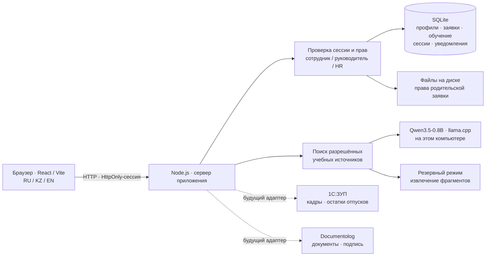
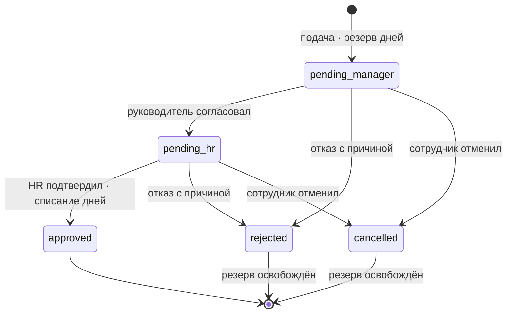

# Архитектура JanaMen

После checkpoint добавлены кадровый профиль (`person_profiles`), снимки печатных заявлений (`request_documents`) и миграция сохранённых демоадресов/текстов без смены паролей. `POST /api/people/:id/profile` разрешён только HR; `GET /api/requests/:id/document` проверяет обычный доступ к заявке и окончательное согласование. Снимок создаётся в одной транзакции с подтверждением HR. У старых одобренных заявок он появляется при первом формировании с явной отметкой.

Испытательный контур `scripts/eval-server.mjs` работает отдельным процессом на loopback-порту 8989. Он использует изолированные фикстуры из `evaluation/`, отдельные токены и временную синтетическую SQLite. В рабочем приложении нет тестовых заголовков выбора снимка или маршрутов `__eval__`. Подключается тот же evidence selector; несовпадение его raw-формата с генеративным контрактом набора сохраняется в отчётах.

Запуск `scripts/launch.mjs` сначала поднимает HR, затем допускает необязательную модель после проверки доступной памяти. `scripts/resources.mjs` выбирает малый профиль для 8 ГБ и учитывает systemd/cgroup. `scripts/ai-process-lock.mjs` предотвращает одновременную загрузку. Ошибка или остановка модели оставляет доступным явно обозначенный поиск по БЗ.

## Компоненты

Единый путь Digital HR: вход → профиль → отпуск → руководитель → HR → уведомление. Academy и ассистент JanaMen AI используют ту же учётную запись. Все кадровые данные и правила в MVP вымышлены.

В разработке Vite обслуживает интерфейс и проксирует `/api` на Node.js. В сборке Node.js обслуживает `dist` и API с одного адреса. SQLite и вложения находятся на постоянном диске. Firebase, Google OAuth и сторонний AI API в новом HR-пути не участвуют.

## Модель данных

| Сущность | Содержание и ограничения |
|---|---|
| Person | Профиль, роль, `managerId`, остаток и резерв; пароль не входит в публичный объект |
| Учётная запись | Хеш scrypt с солью; серверная проверка, без выдачи хеша в API |
| Session | Случайная сессия со сроком действия, HttpOnly-cookie; отзыв при выходе |
| LeaveRequest | Автор, даты, рассчитанные сервером дни, причина, статус, история |
| Attachment | Имя, MIME, размер, связь с заявкой; байты на серверном диске |
| Course | Переведённые уроки и тест, порог прохождения, публикация |
| Enrollment | Назначение, пройденные уроки, балл, результат конкретного сотрудника |
| Notification | Получатель, локализованный текст, сущность, отметка прочтения |
| KnowledgeDocument | Учебный текст RU/KZ/EN, раздел, версия, разрешённая аудитория |

Сервер сам задаёт автора, количество дней и статус заявки. История фиксирует исполнителя и время. Ключи правильных ответов исключаются из данных обучающихся и доступны HR-редактору. Балл вычисляется сервером.

## Роли

| Действие | Сотрудник | Руководитель | HR |
|---|---|---|---|
| Свой профиль и отпуск | Да | Да | Да |
| Данные прямой команды | Нет | Разрешённые сведения | Да |
| Другая команда | Нет | Нет | Да |
| Первое решение | Нет | Прямые подчинённые | Без обхода первого этапа |
| Окончательное решение | Нет | Нет | После руководителя, кроме собственной заявки |
| Создание сотрудников | Нет | Нет | Да |
| Редактор и назначение курсов | Нет | Нет | Да |
| Файл заявки | По правам заявки | По правам заявки | По правам заявки |

Проверки выполняются на сервере для каждого запроса, включая файл и прямой доступ по ID. Скрытые кнопки — только удобство интерфейса. Ассистент фильтрует источники по роли до передачи контекста модели; кадровые записи и пароли в контекст не включаются.

## Согласование отпуска

Календарные дни считаются включительно, без отдельного исключения праздников. Проверяются дата, будущее начало, порядок дат, доступный остаток и пересечения. Повторное решение по завершённой заявке не списывает дни снова. Состояние и остаток сохраняются согласованно в SQLite. Реальный производственный расчёт должен поступать из 1С:ЗУП или утверждённых правил работодателя.

## Academy

HR публикует курс и назначает сотруднику. Сервер сохраняет завершение уроков. После всех уроков обучающийся отправляет варианты ответов; сервер вычисляет балл и сохраняет результат. Порог демокурсов — 80%: при четырёх вопросах нужны четыре правильных ответа. Неуспешный тест можно повторить. События обучения попадают в уведомления.

Курсы «Первые шаги в JanaMen» и «Данные под защитой»: по три урока и четыре вопроса на русском, казахском и английском. Перед производственным использованием нужны проверка переводов и утверждение учебных материалов.

## Локальный ассистент JanaMen AI

`npm run ai:setup` загружает Qwen3.5-0.8B Q4_0 GGUF (около 563 МБ, Apache 2.0). На Linux x64 по умолчанию используется готовый официальный CPU-движок `llama.cpp b8936` (архив около 14 МБ), включающий baseline/AVX1-варианты для старых процессоров. Нужны `curl`, `tar` и около 1 ГБ диска. Релиз и модель зафиксированы; SHA-256 обоих артефактов проверяется перед использованием. Модель не обучалась командой дополнительно.

`node scripts/setup-ai.mjs --build` включает сборку из исходников; она также используется как резервный путь для другой архитектуры. Для неё нужны `base-devel`, `cmake`, `git`, `curl`, около 2 ГБ диска и дополнительное время. По умолчанию длинная компиляция на Linux x64 не выполняется.

`npm run ai:start` запускает процесс только на loopback `127.0.0.1:8766`. Внутренний канал между сервером и движком не требует внешнего сервиса или API-ключа провайдера. Служебный локальный ключ генерируется в `.local-ai/runtime.json`. Рекомендуемый запуск в отдельном терминале, до демонстрации. Число потоков: `ASAR_AI_THREADS` от 1 до 8; порт: `ASAR_AI_PORT`.

Алгоритм:

1. Проверить сессию и разрешённую аудиторию источников.
2. Найти релевантные выдержки из учебных правил.
3. Без подходящего источника вернуть отказ и направить в HR.
4. Локальная модель выбирает ID подтверждающих предложений в ограниченной JSON-схеме.
5. Сервер формирует текст из исходных подтверждённых предложений и показывает открываемые источники.

Нейросеть не сочиняет окончательную кадровую политику. Если движок недоступен, занят или превышен таймаут, показывается честный режим `knowledge_search` с выдержками. Вопрос о собственном остатке обрабатывается сервером по текущей учётной записи; кадровые данные не отправляются модели. Попытка получить чужие сведения не расширяет доступ к документам.

Такой подход позволяет обновлять правила без обучения модели. Поиск не гарантирует идеальную релевантность: перед защитой проверяются типовые вопросы, RU/KZ/EN, неизвестные темы и попытки получить запрещённые сведения.

## Будущие адаптеры

| Граница | Будущий обмен | Что есть в MVP |
|---|---|---|
| PersonnelProvider → 1С:ЗУП | Структура, сотрудники, кадровые атрибуты, остатки | Вымышленные локальные профили |
| LeaveProvider → 1С:ЗУП | Подтверждённый период, внешний ID, результат обработки | Локальная машина состояний |
| DocumentProvider → Documentolog | Регистрация, номер, согласование и подпись | История заявки и серверные вложения |

Названия обозначают архитектурные границы; рабочих подключений, ключей и обмена в MVP нет. Для внедрения нужны согласованные API-контракты, внешний ID и идемпотентность, аудит, повторы при сбоях, защита персональных данных и правила источника истины.

## Запуск, данные и границы

Основной способ — один компьютер с `npm run dev` или собранным приложением. После установки зависимостей и модели сеть для HR-сценария и локального AI не нужна. Разные браузеры подключаются к общему серверу. Вложения хранятся на нём, а не в IndexedDB автора.

Docker использует постоянный том данных; совместимый бинарник модели и веса устанавливаются отдельно. Статического Vercel недостаточно для SQLite на постоянном диске и процесса локальной модели. Для публичного запуска понадобится сервер или разделение хранения и AI-процесса.

Прототип не предоставляет электронную подпись, реальную 1С/Documentolog-интеграцию, юридический расчёт отпуска или промышленное сопровождение. Перед реальным использованием нужны аудит, HTTPS, резервные копии, управление секретами, проверка нагрузки и кадровая экспертиза.

## Соответствие кейсу

| Критерий | Что показываем |
|---|---|
| 30% · сквозной сценарий | Подача → два решения → история → остаток → уведомления |
| 20% · UX | Общая навигация, профиль, адаптивность, RU/KZ/EN |
| 20% · архитектура | Серверные права, сессии, SQLite, проверки прямого ID и чужой команды |
| 15% · Ассистент JanaMen AI | Локальная модель, разрешённые источники, открываемый документ, отказ |
| 10% · Academy | Назначение, уроки, тест, прогресс, редактор HR |
| Передача | README, тестовые учётные записи, эта схема; презентация отдельно |
