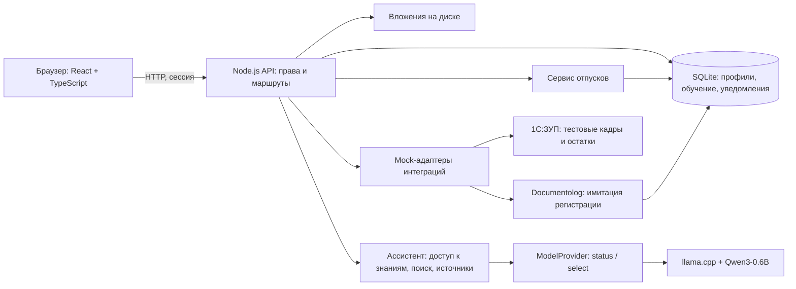
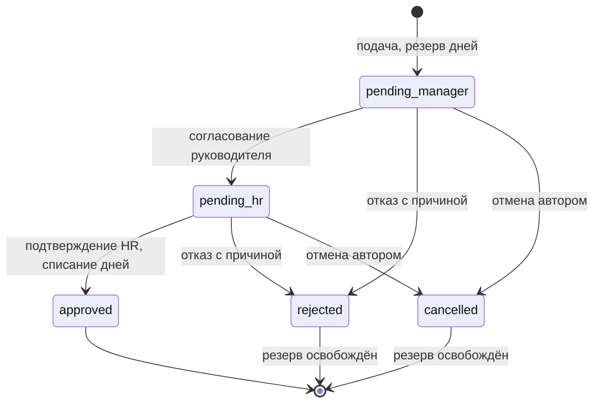

# Архитектура JanaMen

JanaMen — веб-приложение с одним сервером и локальной базой. В разработке интерфейс обслуживает Vite, который проксирует `/api` в Node.js. После сборки Node.js отдаёт и `dist`, и API с одного адреса. Локальная модель работает отдельным процессом.

## Код и хранение

| Модуль | Ответственность |
|---|---|
| `src/hr/App.tsx` | Кабинет, заявки, команда, обучение, ассистент, настройки |
| `src/hr/workspace-sync.ts` | Согласованное обновление данных интерфейса |
| `server/app.mjs` | HTTP, сессии, права, профили, обучение, файлы и интеграционные маршруты |
| `server/leave-service.mjs` | Подача, согласование, отмена, резерв дней, снимок заявления |
| `server/hr-inquiries.mjs` | Обращения из чата к HR, права на переписку, ответы и уведомления |
| `server/store.mjs` | Схема SQLite, миграции, транзакции и общие операции |
| `server/assistant.mjs` | Фильтрация знаний, поиск, проверка выбора модели и цитаты |
| `server/ai/local-model-provider.mjs` | Вызов локального движка, готовность, таймаут и ограничение параллельных запросов |
| `server/knowledge.mjs` | Демонстрационные источники и разрешённые роли |
| `server/integrations/mock-providers.mjs` | Внутренние контракты макетов 1С:ЗУП и Documentolog |
| `scripts/launch.mjs`, `scripts/start-ai.mjs` | Запуск сервера и модели с учётом доступных ресурсов |

SQLite хранит сотрудников, профили, сессии, заявки, историю, курсы, назначения, уведомления и снимки документов. Файлы вложений лежат в `.data/uploads`; права проверяются через родительскую заявку. Серверу нужен постоянный диск. Firebase и Google OAuth из исходного проекта в HR-пути не используются.

## Доступ

Сотрудник читает свои записи. Руководитель получает разрешённые данные непосредственной команды. HR управляет сотрудниками компании, курсами и окончательным согласованием. Каждая серверная операция проверяет роль и доступ к конкретной записи, включая прямой запрос по ID и скачивание файла.

Пароли хранятся как хеши scrypt с солью. Сессия передаётся в HttpOnly-cookie, на сервере хранится хеш случайного токена. При выходе сессия отзывается. Для изменяющих запросов проверяется Origin. Роль и автор заявки берутся из проверенной сессии.

Обычный сотрудник не меняет кадровые поля. В демонстрации профиль редактирует HR; при подключении 1С права на поля нужно согласовать с источником кадровых данных. Собственную заявку нельзя согласовать ни на одном этапе.

## Отпуск и заявление

`createLeaveService` выполняет проверку прав, расчёт дней и переходы состояний. Заявка, остаток, история, аудит и уведомления сохраняются одной транзакцией. Повтор подачи с тем же `clientRequestId` возвращает прежний результат; повторное решение не списывает дни ещё раз.

При финальном подтверждении HR в `request_documents` сохраняется снимок профиля, дат и решений. Печатная форма использует этот снимок, поэтому дальнейшее изменение должности не переписывает заявление. Для старых одобренных заявок без снимка он создаётся при первом открытии с явной отметкой. Это печатный шаблон, без ЭЦП.

Обучение также связано с учётной записью: HR назначает опубликованный курс, сервер сохраняет уроки и рассчитывает результат теста. Правильные ответы доступны HR-редактору и исключены из ответа обучающемуся. Уведомления о заявках и обучении сохраняются в SQLite для своих получателей.

## Ассистент

1. Сервер проверяет пользователя и запрещённые запросы.
2. Из базы знаний выбираются только разрешённые роли документы.
3. Лексический поиск находит до двух подходящих источников.
4. `ModelProvider` передаёт их полные тексты Qwen3-0.6B Q4_K_M через локальный llama.cpp.
5. Модель возвращает номер источника либо `0`. Сервер проверяет формат и выводит текст выбранного источника со ссылкой.

Используются `temperature=0`, `max_tokens=16`, отключённое thinking и таймаут 8 секунд. Одновременно выполняется один запрос. Модель не получает пароли, всю кадровую базу или право менять данные. Вызов движка идёт через HTTP на `127.0.0.1`; облачного AI API нет. Идентификатор модели, ревизия и SHA-256 закреплены в `scripts/ai-model.mjs`.

Если источника нет или модель выбрала `0`, ассистент отказывает. При недоступности движка включается явно обозначенный поиск. Собственный остаток отпуска берётся из доверенных данных пользователя. Точная фраза «Как оформить отпуск» возвращает подготовленную цитату в отдельном режиме `demo_quote`. Эти два пути не выдаются за результат нейросети.

Источники открываются по защищённой ссылке и содержат версию, происхождение и SHA-256. Такое цитирование позволяет проверить ответ, но само по себе не гарантирует, что модель выбрала подходящий документ. Результаты и ограничения измерений приведены в [испытаниях ИИ](../evaluation/README.md).

## Передача вопроса HR

Из ответа ассистента пользователь открывает форму и подтверждает вопрос. Сервер сохраняет обращение от имени пользователя сессии и уведомляет HR его компании. Руководитель не получает доступ к обращениям команды. HR отвечает от своего имени; автор получает уведомление и видит вопрос, ответ, статус и дату в сохранённой истории.

| Маршрут | Назначение |
|---|---|
| `GET /api/hr-inquiries` | Обращения, доступные текущему пользователю |
| `POST /api/hr-inquiries` | Отправка подтверждённого вопроса |
| `GET /api/hr-inquiries/{id}` | Вопрос и ответ с проверкой доступа |
| `POST /api/hr-inquiries/{id}/answer` | Ответ HR компании автора |

В `hr_inquiries` хранятся вопрос, язык, автор и ответ специалиста. Доступ HR определяется компанией автора из кадровой записи. `hr_inquiry_submissions` связывает идентификатор отправки с результатом для безопасного повтора запроса. Создание обращения, ответ, аудит и уведомления фиксируются транзакционно. Повторная отправка не создаёт дубли, а повтор ответа не изменяет уже опубликованный текст. Вся переписка выводится как текст. Передача вопроса не меняет настройки модели и не пополняет базу знаний автоматически.

## 1С:ЗУП и Documentolog

ТЗ разрешает mock API вместо промышленных интеграций. В JanaMen есть отдельный HR-экран и локальные адаптеры в `server/integrations/mock-providers.mjs`. Они описывают внутренний контракт приложения, а не протокол конкретной установки поставщика.

| Маршрут | Назначение |
|---|---|
| `GET /api/integrations` | Каталог и режим |
| `GET /api/integrations/1c-zup/employees` | Два вымышленных сотрудника |
| `GET /api/integrations/1c-zup/leave-balances` | Тестовые остатки |
| `POST /api/integrations/1c-zup/sync-preview` | Предпросмотр сопоставления, без импорта |
| `POST /api/integrations/documentolog/documents` | Регистрация по `requestId` согласованной заявки |
| `GET /api/integrations/documentolog/documents/{id}` | Сохранённый демодокумент |
| `POST /api/integrations/documentolog/documents/{id}/mock-transition` | Имитация изменения статуса |

Все маршруты доступны только HR. Режим задаётся на сервере: `JANAMEN_INTEGRATIONS_MODE=mock` по умолчанию, `off` отключает операции. `live` не поддерживается. Ответы явно указывают `externalRequestSent: false`, а каталог — `connected: false`.

Макет 1С возвращает собственные фикстуры с `MOCK-*` ID. Предпросмотр отмечен `dryRun: true`, `applied: false` и не меняет сотрудников или отпускной баланс.

Макет Documentolog берёт поля из серверного снимка окончательно согласованного заявления. Повторная регистрация возвращает тот же документ, в том числе после перезапуска. В SQLite сохраняются ID, SHA-256 содержимого, история и признаки `signed: false`, `legallySignificant: false`. Статусы идут от `registered` к `in_review`, затем `completed` или `rejected`; из `registered` также допустим отказ. Завершение обработки документа не меняет отпуск и не означает электронную подпись.

Для реального подключения адаптеры заменяются реализациями под API заказчика. Нужно согласовать внешние ID и владельца каждого поля: кадровые сведения и остатки — с 1С, внешний номер и документооборот — с Documentolog. Ключи остаются на сервере. Понадобятся повторы с устранением дублей, обработка ошибок и проверка входящих событий. Внешний обмен следует выполнять после фиксации кадровой транзакции через очередь событий, чтобы сбой Documentolog не откатывал отпуск.

## Запуск и проверка

`npm start` обслуживает сборку; модель подключается при наличии установленных файлов. Проверки памяти и блокировка запуска предотвращают одновременную загрузку нескольких экземпляров модели. Для переноса нужны Node.js, собранный интерфейс и движок под ОС целевого компьютера — см. [README](../README.md).

Автотесты проверяют роли, переходы заявок, повторы, документы, обучение и mock-интеграции на временной SQLite. Проверки ИИ с заглушкой подтверждают поведение кода; качество настоящей модели оценивается отдельными прогонами. Приложение и испытательный адаптер используют разные базы и сессии.
