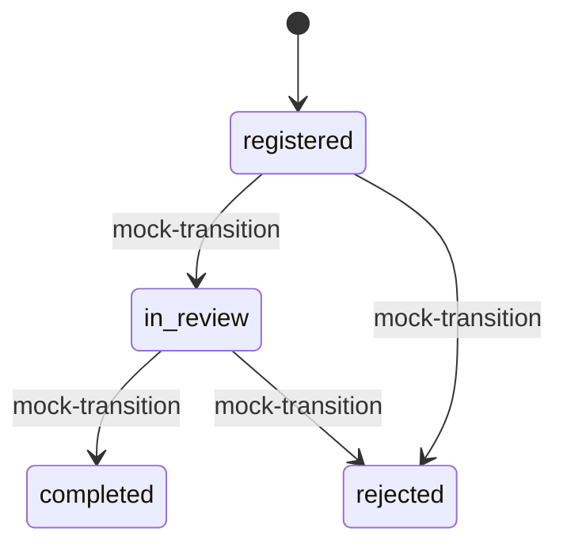

# Прототип интеграций JanaMen

Это внутренний API JanaMen для демонстрации мест подключения 1С:ЗУП и Documentolog.
Он не копирует протокол конкретной установки поставщика и не заявляет совместимость
с её API. Реальных сетевых вызовов, ключей, ЭЦП и отправки документов нет.

## Роли и экран

В текущей модели ролей раздел **«Интеграции»** видит только HR. Все маршруты,
включая каталог и чтение статуса документа, требуют HR-сессию `asar_session`.
Сотрудник и руководитель получают 403; без входа — 401. Проверка выполняется на
сервере независимо от наличия пункта меню. Межсайтовые POST-запросы проверяются
общим механизмом Origin приложения.

HR просматривает данные и проверяет обмен. Для настоящего подключения адреса,
секреты и права сервисных аккаунтов должен настраивать технический администратор
с отдельными полномочиями. Такой роли в этом прототипе пока нет. Экран не собирает
настоящие API-ключи и не создаёт впечатление, что подключение уже выполнено.

## Режим

`JANAMEN_INTEGRATIONS_MODE=mock` — режим по умолчанию. `off` оставляет каталог,
но операции возвращают 503 `integration_disabled`. Указание `live` или произвольного
значения останавливает создание приложения с явной ошибкой. После смены переменной
нужен перезапуск сервера. Через браузер режим и права доступа не меняются.

Все ответы адаптеров содержат `schemaVersion: janamen.integration.v1`, `mode: mock`,
`externalRequestSent: false`. Каталог показывает `connected: false`.

## Маршруты

| Метод | Путь | Результат |
|---|---|---|
| GET | `/api/integrations` | Каталог, режим и доступные операции |
| GET | `/api/integrations/1c-zup/employees` | 2 фиксированных вымышленных сотрудника |
| GET | `/api/integrations/1c-zup/leave-balances` | Учебные остатки на 17.10.2026, не актуальная выгрузка |
| POST | `/api/integrations/1c-zup/sync-preview` | `{}` → нормализованные записи, `applied: false` |
| POST | `/api/integrations/documentolog/documents` | `{requestId}` → 201 при регистрации, 200 при повторе |
| GET | `/api/integrations/documentolog/documents/{id}` | Сохранённый демодокумент |
| POST | `/api/integrations/documentolog/documents/{id}/mock-transition` | `{status}` → имитация следующего статуса |

1С возвращает собственные фикстуры с `MOCK-*` ID, а не кадровую БД приложения.
`sync-preview` не импортирует их: `dryRun: true`, `applied: false`, `mappingRequired: true`.
Соответствие сотрудников реальным внешним идентификаторам ещё нужно настроить.

Documentolog получает только `requestId`, остальные поля берёт сервер из снимка
окончательно согласованного заявления. До согласования — 409 `document_not_ready`;
неизвестная заявка — 404. Лишние поля, включая `signed`, URL или payload, — 400.
Для старой одобренной заявки без сохранённого снимка создаётся снимок текущего
профиля с `capturedOnApproval: false`, как в печатной форме приложения.

Дедупликация по `requestId` сохраняется между перезапусками. Документ содержит
снимок, SHA-256 сериализованного payload, ID `MOCK-DOC-*`, историю и явные
`signed: false`, `legallySignificant: false`. Вложения не передаются.



Повтор текущего статуса идемпотентен; недопустимый переход — 409.
`completed` означает завершение демообработки, не подписание или одобрение отпуска.
Регистрация и изменения статуса записываются в `audit` с префиксом `documentolog_mock_`.
Кадровые заявки, остатки и профили при этом не меняются.

## Примеры

Используйте cookie-файл существующей HR-сессии и ID согласованной заявки:

```bash
curl -b cookies.txt http://127.0.0.1:3000/api/integrations
curl -b cookies.txt -H 'Content-Type: application/json' \
  -d '{}' http://127.0.0.1:3000/api/integrations/1c-zup/sync-preview
curl -b cookies.txt -H 'Content-Type: application/json' \
  -d '{"requestId":"REPLACE_WITH_APPROVED_REQUEST_ID"}' \
  http://127.0.0.1:3000/api/integrations/documentolog/documents
curl -b cookies.txt -H 'Content-Type: application/json' \
  -d '{"status":"in_review"}' \
  http://127.0.0.1:3000/api/integrations/documentolog/documents/REPLACE_WITH_MOCK_DOC_ID/mock-transition
```

В браузере: войти HR → «Интеграции» → «Проверить обмен». Для Documentolog выбрать
согласованную заявку, зарегистрировать демодокумент и пройти имитацию рассмотрения.
Если согласованных заявок нет, экран предлагает перейти к заявкам. Повторная
регистрация после открытия экрана восстанавливает тот же документ и его статус.

## Переход к настоящим сервисам

1С:Предприятие поддерживает [HTTP-сервисы](https://v8.1c.ru/platforma/http-servisy/)
и [REST/OData](https://v8.1c.ru/platforma/rest-interfeys/). Это возможности платформы;
набор сущностей, реквизиты ЗУП и доступность опубликованной базы надо согласовать
с администратором конкретной установки.
Documentolog описывает [API-интеграцию](https://documentolog.com/integrations/api).
Контракт нужной редакции и среды, адреса, авторизация и полномочия должны быть
получены у владельца установки; проверка реального соединения здесь не выполнялась.

Моковые провайдеры заменяются серверными адаптерами, сохраняющими внутренние
нормализованные ответы JanaMen. Перед внедрением нужно определить источник истины,
сопоставление внешних ID, правила конфликтов и обновления остатков, таймауты,
повторные доставки, идемпотентность и проверку входящих событий. Подпись — отдельный
согласованный процесс, не значение статуса. Ввод произвольного URL через этот API
не предусмотрен.

## Проверка

```bash
node --test --test-isolation=none --test-name-pattern='integration|1C|Documentolog' tests/hr.test.mjs
npm test
npm run lint
npm run build
```

Интеграционные тесты используют временную SQLite и реальный локальный HTTP:
роли, dry-run, запрет регистрации до согласования, повторная регистрация, переходы,
перезапуск, неизменность кадровых данных, отключение адаптеров и Origin.
